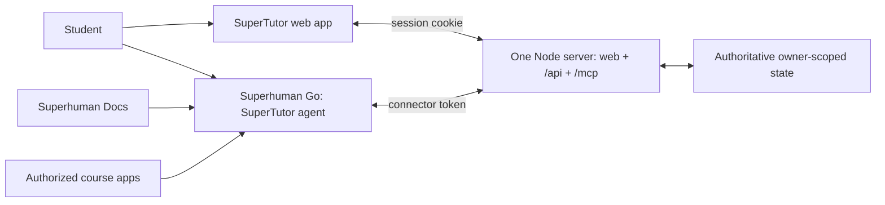

# Architecture: Go tutors, SuperTutor provides tools

This supersedes the earlier plan that ran four Claude personas in `apps/api`, and the local two-process demo that preceded the web app.

## Responsibilities

- **Go** reasons about student work, asks diagnostic questions, explains concepts, generates practice, chooses hints, and evaluates understanding. Go's assessments are not independently verified grades.
- **Server** validates data and returns/persists context, drafts, attempts, feedback, and derived progress. It never calls a model.
- **MCP router** exposes the same store as six tools, bound to the account that owns the presented connector token.
- **Web app** captures work and displays saved feedback. Go chat is a separate surface; the app guides the student to it and never claims to control it.
- **Canvas** is read with the student's own access token, server-side, to import an assignment's instructions, due date, and link. It is read-only and never touches grades or submissions. Other sources from the product plan are declared with honest status rather than implemented.

## One server, one store

The server process instantiates `TutorStore` once and hands the same instance to the API router and the MCP router. Every write is validated and atomically persisted before replacing in-memory state. The MCP router no longer calls the API over HTTP: in one process that would be a loopback round trip with a second validation layer, so the tools call the store directly with the same shared Zod schemas.

Every record carries an `ownerId`. The store resolves the owner from a session cookie or a connector token and treats a record belonging to anyone else as missing. Route-level checks and store-level checks both enforce this, and the tests assert it from both directions.

Attempts retain history. Feedback is upserted by attempt ID so retries do not double-count reviews. `clientRequestId` optionally makes attempt retries idempotent. Progress is derived from saved records; topic mentions are historical, not a mastery score. No hint request alone completes a task.

## Trust boundaries

The server binds to loopback unless `HOST` says otherwise, and the whole origin is public once deployed. The browser surface is protected by an HttpOnly SameSite=Lax session cookie; `/mcp` is protected by a per-student bearer token stored as a hash. Revoking a token takes effect on the next request.

Student work, course excerpts, and anything a future course connector imports are **untrusted input to the tutor**, not instructions. The tool descriptions say so, and that discipline has to survive any ingestion feature added later.

Only explicitly saved work is available. Editing on paper or in a local editor does not automatically feed this service. Course links are preserved as references; the service does not download videos or infer transcript content.

There is no code runner or symbolic checker. The workspace gives the student a real editor (Monaco, with the same editing interface as VS Code) but does not execute anything, so there is no sandbox to escape. Go should reason transparently and return uncertainty when evidence is insufficient. Future verification tools must return actual evidence rather than a model confidence claim.

## Student-supplied hosts

The Canvas base URL comes from the student, which makes an import a server-side request to an address this app does not control. Every Canvas call requires HTTPS, resolves the hostname and refuses private, loopback, and link-local addresses, declines redirects, caps the response, and times out. The client is injected (`canvasClient`) so tests can cover the routes without weakening that guard — production always uses the live client.

A Canvas token is the only live third-party credential in the store. It is kept because imports run on the server, it is never returned by any route, and disconnecting deletes it.

## Where triggers can and cannot fire

A Superhuman `while-writing` trigger fires only on Superhuman's own surfaces, such as Docs and Email. It cannot fire inside this web app, so proactive tutoring is available when the student writes in a Doc, and the workspace relies on the student asking Go directly. The workspace can still nudge, because it knows when work was saved and when feedback last arrived.

## Folders and owners

Albert: `apps/api/**`. Ian: `apps/web/**`. Ainesh: shared contracts and state in `packages/**`, the server in `apps/server/**`, `scripts/**`, `agents/**`, `.github/**`, root config and docs. This coordinated migration updates all lanes once; future changes follow the ownership map in README.

## Proof required

Local SDK integration tests prove tools can be listed and called over authenticated Streamable HTTP, that one student's token cannot reach another's work, and that a version 2 state file migrates without losing work. They do not prove the connector is installed in Go. Ainesh must still demonstrate a real Go request reading context, useful tutoring, and feedback written back to the workspace.
