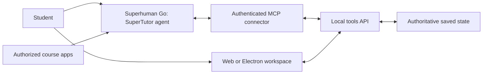

# Architecture: Go tutors, SuperTutor provides tools

This supersedes the earlier plan that ran four Claude personas in `apps/api`.

## Responsibilities

- **Go** reasons about student work, asks diagnostic questions, explains concepts, generates practice, chooses hints, and evaluates understanding. Go's assessments are not independently verified grades.
- **API** validates data and returns/persists context, drafts, attempts, feedback, and derived progress. It never calls a model.
- **MCP bridge** exposes the API's capabilities as tools. It is an HTTP client of the API, not a second state owner.
- **Workspace** captures work and displays saved feedback. Go chat is separate; no embedded/external Go invocation is assumed.
- **Course connectors** may supply authorized materials to Go. Canvas/video access is not implemented or implied by this repo.

## One brain, one store

The API process instantiates `TutorStore`. Every write is validated and atomically persisted before replacing in-memory state. The MCP process calls API routes over HTTP; importing a shared module in two processes would not share its memory.

Every context and tool operation uses an assignment ID. Attempts retain history. Feedback is upserted by attempt ID so retries do not double-count reviews. `clientRequestId` optionally makes attempt retries idempotent. Progress is derived from saved records; topic mentions are historical, not a mastery score. No hint request alone completes a task.

## Boundaries

The API and MCP bind to loopback. Tunnel only the token-protected MCP service. The local API has no user authentication and must not be exposed. The bridge token authenticates one demo workspace, not individual students. Multi-user isolation requires a separate design.

Only explicitly saved work is available. Editing in VS Code or on paper does not automatically feed this service. Course links are preserved as references; the service does not download videos or infer transcript content. Source material remains untrusted input to the tutor.

There is no code runner or symbolic checker. Go should reason transparently and return uncertainty when evidence is insufficient. Future verification tools must return actual evidence rather than a model confidence claim.

## Folders and owners

Albert: `apps/api/**`. Ian: `apps/web/**`. Ainesh: shared contracts/state, `scripts/**`, `agents/**`, desktop, root config and docs. This coordinated migration updates all lanes once; future changes follow the ownership map in README.

## Proof required

Local SDK integration tests prove tools can be listed and called through authenticated Streamable HTTP. They do not prove the connector is installed in Go. Ainesh must demonstrate a real Go request reading context, useful tutoring, and feedback written back to the workspace.
